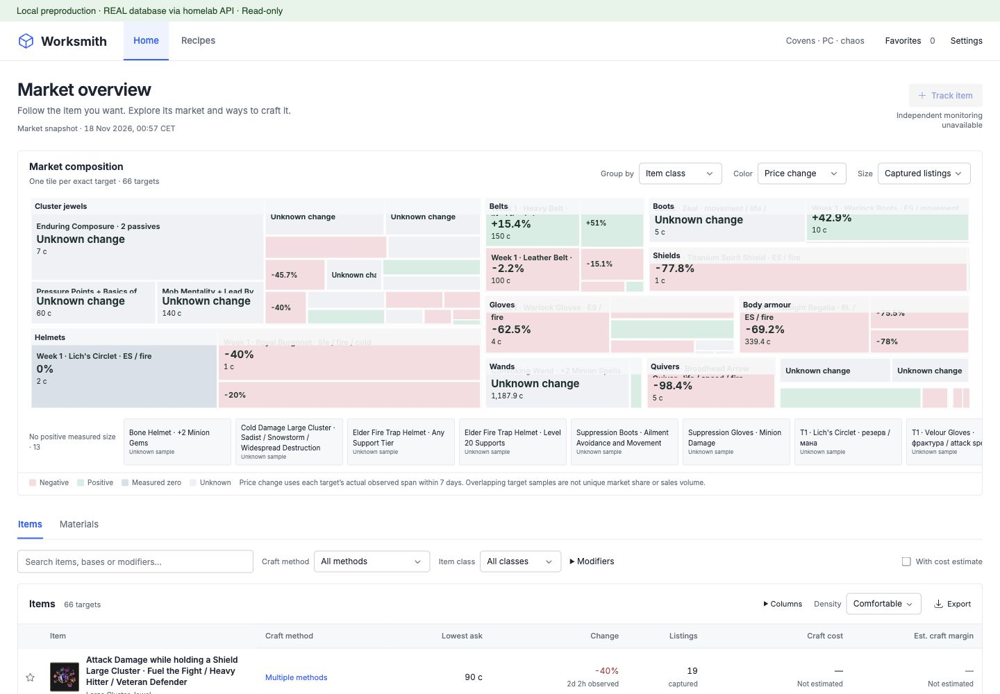

# Home integration and legacy UI removal

This follow-up corrects the missing Home integration in PR #114. Normal `/` now renders the approved full-width Market overview, Market composition, filters and exact-target table. The previous `CatalogRoute`, `CatalogOverview`, `CatalogTable`, unused table/filter adapters and their obsolete tests/styles were deleted. Shared header and popup CSS each have one owner instead of competing page overrides. Existing actually-used deep links remain.

## Actual-data acceptance

Verified on 18 November 2026 against the existing homelab database-backed API, not the archived fixture. At inspection the current catalogue contained 72 recipes / 66 exact outputs; prices, observations, material quotes and absent estimates were passed through from the live API. Current server definitions were read from the existing database in a READ ONLY transaction to provide the additive family/method metadata required by this branch. A loopback-only temporary development gateway exposes those fields without changing quotes or synchronizing older checkout recipe files into the live database. Real database writes and deployment were not performed.

Observed: proportional captured/asking modes had 53 sized targets and 13 without positive measured size; Equal tiles included all 66. Fossil scope yielded 12 exact outputs, excluded Chaos routes in the popup, and preserved filters on close. Exact recipe steps and unit quotations came from the actual database response; Market used that target's real observations. No recorded trades or realized profit were claimed. A missing craft estimate is not by itself evidence of a bad Trade query.

The shared header measured **57px high / 13px text on both Home and Recipes at 1440px**. Document width equaled viewport at 768px and 390px. Popup geometry remained **1140×952 at x150/y24** through Market/Recipe switching in a 1440×1000 viewport. At 390×844 the dialog was 374px wide with footer controls inside the viewport. The live graph measured 767×220 desktop / 348×220 mobile after fixing an icon-size selector that had leaked onto chart SVGs. The target table scrolls inside its own focusable region.

## Validation and review

- Node 22 / pnpm 11: web typecheck, lint and full build passed; the existing bundle-size warning remains.
- Web unit suite: 143 passed after removing obsolete Home-only tests and adding meaningful model/export/header/popup checks.
- Existing light browser suite: 63 passed at desktop/tablet/mobile. Additional focused checks cover full-size popup graphs, catalogue rendering while trends hang, ARIA tabs, filter-scoped 50/70 costs and 50/30 spreads, CSV and preset independence.
- Category Library suite: 27 passed; six viewport duplicates of desktop-only failure/context/deadline scenarios skipped.
- Tests with explicit fixtures supplement the live acceptance above; fixtures are not the final UI data source.
- Claude reviewed both code and the real-data screenshots. Retained findings included numeric CSV export, asynchronous catalogue loading, unsupported sorts, source-bound timestamps, chart-size CSS leakage, zero/unknown labels, tiny-group headers and stable dialog geometry. These were addressed before checkpointing this unit.

Independent target creation, monitor-only UUID/version ownership and history migration still require backend integration. The Track item control and No recipe filter are explicitly unavailable on the current deployment; a browser favorite is not presented as a running monitor. The subsequent Settings → Scraped items unit is separately authored by Claude in this same PR.

