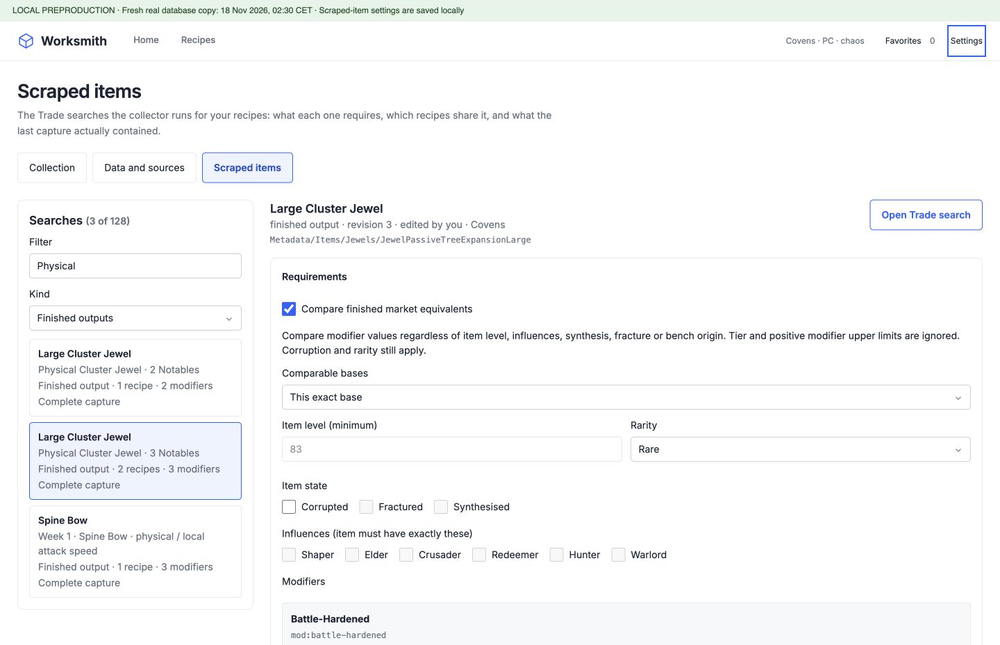
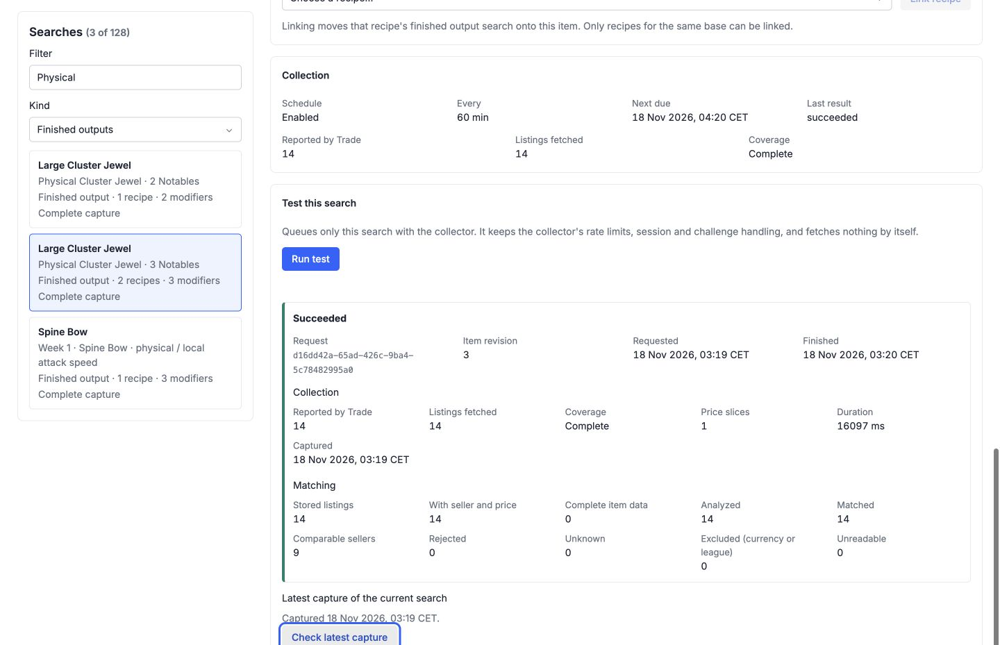
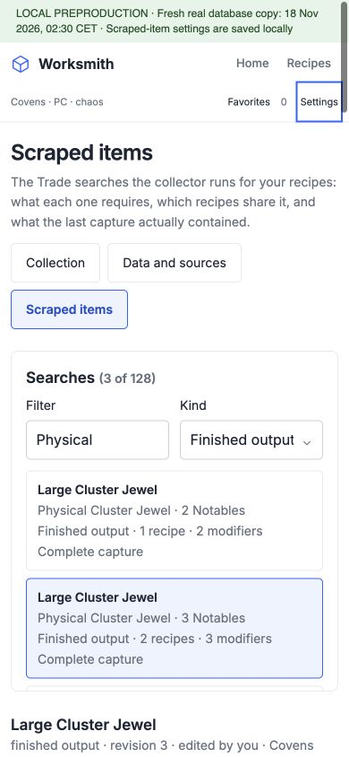

# Scraped items: actual-data acceptance

Settings → Scraped items edits persisted starting-base and finished-output searches, links recipes, opens the generated Trade query and runs one correlated collector test. API → PostgreSQL `run_requests` + transactional `pg_notify` → collector `LISTEN` → persisted capture/result. There is no API-to-worker HTTP connection.

## Current full audit

The [full real-data audit](full-real-audit-2026-11-18/) covers **128 configured searches and all 72 active recipes**, including the original full batch, its failed Slink request and successful correlated recovery. Machine-readable per-search and per-recipe receipts distinguish actual asking estimates from missing evidence. [Review and checks](full-real-audit-2026-11-18/review-and-checks.md) records Claude authorship, independent review, reproduced findings and validation.

Acceptance uses a local PostgreSQL 18.6 copy of the actual homelab database, copied on 18 November 2026 at 02:30 CET, followed by fresh authenticated Trade collection. There are 72 active recipes, 66 outputs and 128 searches. The loopback frontend uses the normal shipped API and collector. No archive responses, synthetic listings or fixture quotes serve this acceptance environment. Writes affect only the local copy; production was not modified.

The audit corrects nine query identities intentionally: five acquisition searches retain their native implicit floors; two ordinary helmet comparisons use the supported helmet category; two RF searches send current provider support-effect IDs. The seven authored recipe changes update their content hashes and fence old economics. Canonical recipe identities, crafting inputs and exact acquisition constraints remain intact. Finished-item comparisons continue to enforce the authored result modifiers; owner edits never redefine recipe eligibility.

Parser corrections recognize actual modern support effects and crafted/fractured local weapon stats. Exact official helmet metadata resolves the observed Prophet Crown without guessing classes from arbitrary names. Unconverted currencies can be ignored only for definitely rejected items. Partial/uncertain matching evidence cannot become a comparable asking estimate. Independent capture/FX deadlines preserve a fresh output quote when craft inputs expire, while expired cost, budget and ROI remain withheld. A recipe's authored profit block no longer hides a qualifying asking quote; it still blocks both catalog ROI and outcome valuations.

## Initial compatibility baseline — before intentional audit corrections

These receipts describe source `a364812`, before the nine deliberate query corrections above. They are historical acceptance evidence, not claims that the corrected queries remain byte-identical.

The older checkout would disable 18 active deployed definitions and change five records, including reactivating retired Fugitive Boots. The restored baseline preserved the live image's 72-recipe catalogue, 30 additional Trade stat mappings and provider normalization; the retired source file was removed. Its dry run reported **72 unchanged; 0 created, updated, disabled or failed**. All **144 authored base/output queries** matched the then-active deployed compiler; all **128 generated links** matched worker requests. See [compatibility](query-compatibility.json), [mapping identities](trade-identities-2026-11-18.json) and [startup receipt](catalog-preservation.json).

## Initial browser and real-worker acceptance

On the actual database copy, changed the Physical three-notable search to strict level 84, saved revision 2, reloaded and verified persistence, then restored level 83/equivalent as revision 3. Old-query captures were not relabeled.

A browser **Run test** created scope `item`, revision 3 and the exact schedule key. The worker woke in **23 ms**, dispatched one search and fetched/matched **14 real listings**, with **9 comparable sellers**, in **16,097 ms**. The UI showed those persisted results: [receipt](real-worker-result.json). Repeated through normal shipped entrypoints: **12 fetched/matched, 7 sellers**, wake **4 ms** ([receipt](normal-entrypoint-result.json)). A browser starting-base test fetched/matched **20** from **141 reported**, correctly retaining partial mixed-currency coverage ([receipt](normal-base-result.json)). Later captures in the full audit are separate observations.

Trade does not establish exhaustive modifier absence, so `completeItems: 0` remains honest. Positive matching evidence can satisfy requirements without asserting that all absent modifiers are proven absent.

Initial desktop 1440×1000 and mobile 390×844 checks showed no horizontal overflow. Navigation measured 57px high with 13px text; controls and diagnostics stayed contained. The browser suites also cover late list/capture responses, transient polling failure, filter-reset navigation, mobile partial quotes and unverified Fettle ROI.

Historical initial checks: 988 unit tests plus native self-check; 208 isolated PostgreSQL integration tests; 75 light browser checks; 27 Category Library checks with six duplicate viewport cases skipped; 25 database-backed browser checks with nine pipeline-specific cases skipped; two offline preview checks. Current source checks are recorded in the full-audit folder. Skipped cases were not executed in those configurations. Fixtures supplement tests and never serve final actual-data acceptance.

## Scope and rollout

Production rollout was not performed. Migrations **0035–0036 require a coordinated old API/collector stop**, backup and matched-version startup; application-only rollback across the new queue schema is unsupported. Follow the root README's release/rollback boundary. Verify one item test, an existing all/recipe refresh, request/capture correlation and old-query price fencing before opening access.

Independent monitor-only target storage/lifecycle remains outside this PR, with its controls unavailable. Actual crafting and confirmed sales/realized ROI were not checked. Asking quotes and modeled costs do not prove sales or profit.

## Initial actual-data screenshots

These show the initial browser acceptance; the full-audit folder contains the later final checks.

