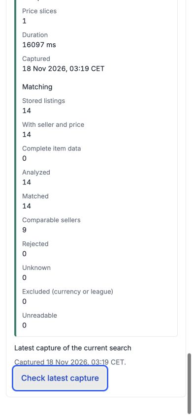
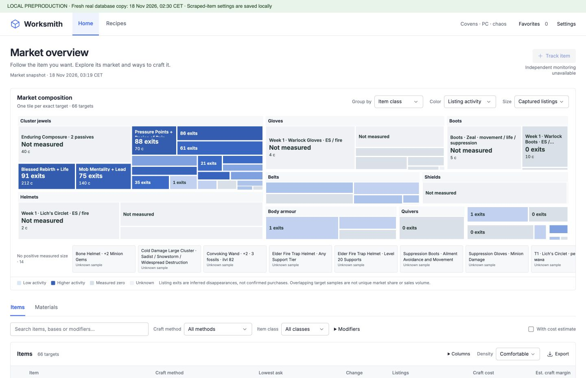

# Scraped items: actual-data acceptance

Settings → Scraped items edits the persisted searches for starting bases and finished outputs, links recipes, opens the exact Trade query and runs one correlated test through the collector. API → PostgreSQL `run_requests` + transactional `pg_notify` → collector `LISTEN` → persisted capture/result. No API-to-worker HTTP endpoint exists.

## Data and execution

Verified on 18 November 2026 using a local PostgreSQL 18.6 copy of the current homelab database, copied at 02:30 CET: 72 active recipes, 66 exact recipe outputs and 128 configured base/output searches. No archive responses, mocked quotes, synthetic listings or recipe-file bootstrap served the final browser. The final loopback frontend uses the normal shipped API and collector entrypoints; writes affect this local copy. The initial bounded smoke test also imported the same application services directly. Production data and deployment were not changed.

The live deployment carries additional recipe definitions and collector behavior beyond the checked-in baseline. This PR preserves its 30 additional Trade stat mappings, socket/resistance/provider-markup normalization and finished-market equivalence. All **144 authored base/output queries** for the actual 72 recipes matched the active compiler byte-for-byte. All **128 persisted searches** compiled successfully, and each generated Trade URL decoded to the worker's exact wire request. See [query compatibility](query-compatibility.json).

Starting bases retain exact acquisition constraints. Finished searches default to the deployed equivalent-market policy: modifier floors across fracture/bench origins, without item-level/influence/synthesis/fracture restrictions; only the three already-supported class-wide policies are offered. The editor explains ignored fields, permits explicit strict searches and keeps recipe eligibility separate from owner edits. Class matching uses checked metadata and the existing bounded English suffix fallback; unsupported evidence remains unknown.

## Startup preserves the deployed catalogue

A read-only startup dry-run exposed source drift: the old 55-file checkout would disable 18 active recipes and change five records, including reactivating retired Fugitive Boots. This PR preserves the active image’s 72-recipe catalogue, mapping/base metadata and presentation; the retired source file is removed while unrelated drafts remain. The same dry-run now reports **72 unchanged; 0 created, updated, disabled or failed**. A normal API startup on the copied database retained all 72 recipes and 128 searches. Current public Trade metadata independently validates the preserved mapping identities; see [identity receipt](trade-identities-2026-11-18.json) and [startup receipt](catalog-preservation.json).

## Browser and real collector result

The actual Physical three-notable output is linked to two recipes. Through the UI, changed equivalent matching to strict, saved item level 84 as revision 2, reloaded and verified persistence; restored the original level 83/equivalent search as revision 3. Earlier-query captures were not relabelled. Modifier names, recipe links, current generated Trade URL, schedule state and capture facts came from the copied database.

Clicked **Run test** in the browser. The request persisted scope `item`, revision 3 and the exact current schedule key. The collector started **23 ms** after enqueue, dispatched **one search** and created **one capture**; no unrelated schedules ran. The real Trade response reported/fetched **14 listings** in **16,097 ms**. Current normalization matched **14**, with **9 comparable sellers**, **0 rejected** and **0 unknown**. The page displayed Succeeded and those same values. [Persisted request/capture evidence](real-worker-result.json) contains no seller accounts, session material or credentials.

Repeated the selected output through the **normal shipped API and collector entrypoints** after preserving the catalogue: **12 fetched/matched, 7 comparable sellers**, 0 rejected/unknown; worker wake **4 ms** ([request evidence](normal-entrypoint-result.json)). A separate browser test of the Hunter Amethyst Ring starting base fetched/matched **20**, with **20 comparable sellers**, from **141 reported**. Its coverage correctly remained **Partial / MIXED_CURRENCY_SLICE_UNPROVEN**, rather than claiming a complete market ([base request](normal-base-result.json)). These are later live observations, not replacements for the earlier capture.

Complete item data remains 0: Trade does not establish exhaustive modifier absence. That does not prevent positive evidence from satisfying the selected requirements, and is not presented as a failed capture or proven absence.

Desktop 1440×1000 and mobile 390×844 use the same actual data. Document width matched each viewport; controls and capture diagnostics remained contained. Shared Home/Recipes navigation measured 57px high with 13px text. Browser race tests additionally cover late list/capture responses and transient polling failure.

## Verification and review

- Full unit suite: 988 passed, plus the native service-control self-check.
- PostgreSQL 17 integration suite: 208 passed, including item-only dispatch, configuration revisions, relink concurrency, stale prices, unsupported mappings and capture coherence.
- Browser suites: 75 light checks; 27 Category Library checks with 6 duplicate viewport cases skipped; 25 database-backed checks with 9 fixture/pipeline-specific cases skipped; 2 offline preview checks.
- Typecheck, lint, full build, migration consistency and changed-file formatting passed. Existing bundle-size warning remains.
- Claude authored the feature and backend corrections. After its provider quota stopped execution, the documented fallback completed the remaining work. All nine retained formal-review findings were closed; a [bounded review](bounded-review.md) checked the final compatibility and UI policy changes.

Automated fixtures supplement the actual-data acceptance; they are not the final data source. Browser tests skipped by their pipeline/viewport guards were not executed in those configurations.

Production rollout has not been performed. Migrations 0035–0036 require the coordinated old-API/old-collector stop and rollback boundary documented in the root README. Independent monitor-only target storage/lifecycle, actual crafting and confirmed-sale/ROI verification remain outside this PR. Asking prices and modeled margins do not prove sales or realized profit.

## Screenshots

