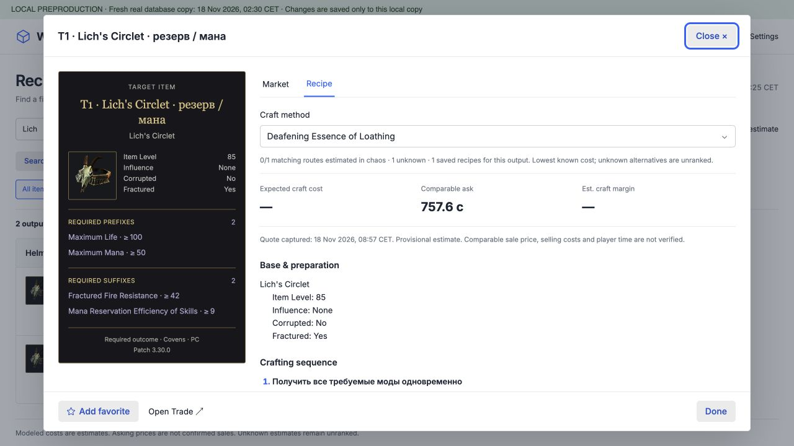

# Full real-data audit — 18 November 2026

All **128 current configured searches** have actual authenticated Trade captures after the full-run start, and all **72 active recipes** have both their acquisition and output searches collected. The original full request remains failed (130 successful jobs, one failed, none pending): one Slink query hit the old handler deadline. Its correlated updated-worker recovery succeeded with 100 matched listings and 99 sellers. A final freshness refresh is still running; its terminal receipts and the final 72-recipe current-price table follow that refresh.

The database is the actual homelab copy plus fresh real provider collection. Normal shipped API/collector entrypoints serve it. No fixture/archive responses serve browser acceptance, and production is unchanged.

## Reproduced defects and fixes

- [Same immutable captures](same-capture-parser-proof.json): Spine Bow matching **23 → 49**, modeled asking estimate **25 → 8 chaos**. This is parser comparison on one actual capture, not an invented quote or a changed market. The raw matching minimum stayed 8; newly recognized matches changed outlier selection. Thicket matching improved 8 → 9. A matching mirror-priced item remains blocked; an irrelevant fusing-priced item clears the currency block only after definite rejection.
- [Native acquisition replay](native-acquisition-replay.json): six unsuitable bases among 106 observations across the three affected captures; all five configured native-implicit acquisition guards verified. New acquisitions use the required modifier floors.
- [RF full-goal A/B/A](rf-support-aba.json): legacy support IDs returned zero, current effect IDs returned 118 full-goal matches, legacy IDs again returned zero. Only the two IDs changed. This temporary allow-list worker was diagnostic only and its schedules were disabled afterward.
- [Final normal-entrypoint tests](normal-final-wire-tests.json): RF Any fetched/matched 100/100 with honest partial coverage; RF level 20 fetched/matched 13/13, complete; ordinary helmet returned one actual Prophet Crown and matched it. The normal compiler/worker now send current wire IDs while preserving canonical identities and all other requirements.
- [Eleven correlated correction tests](corrected-search-tests.json) preserve their original state/diagnostics. The two early helmet results were unknown under the then-current class map; exact official helmet metadata and the subsequent normal test above close that defect. Historical receipts are not rewritten to pretend the matcher was already fixed.
- Fresh asking evidence has an independent capture/FX deadline. Expired crafting inputs do not hide an otherwise current output quote. Author-defined profit blocks no longer hide matching asking quotes, but still block catalog ROI, grades, success and downstream outcome valuations.

## Review and browser acceptance

[Checks, actual Claude review and peer finding closure](review-and-checks.md). At source `0f61a1f`, **1,033 automatic tests + 208 isolated PostgreSQL integration tests** pass, as do [quality and server-compose](https://github.com/MaksimSurmach/POE_WA/actions/runs/44265592133). Later commits have their own exact-head GitHub checks.

[Browser receipt](browser-check.json): actual Lich asking estimate **757.6 chaos**, one matched item/seller, complete capture, with cost and margin left unknown. Recipe and Market agree. Settings show All helmets and the original four modifier floors; current diagnostics show 1 matched, 0 unknown. Desktop 1280px and mobile 390px have no horizontal overflow. The historical recipe-update notice remains historical in both places.

[Market view](market-price-real.jpg) · [Saved search and actual matching](settings-match-real.jpg) · [Mobile requirements](recipe-mobile-real.jpg) · [Mobile price](recipe-mobile-price-real.jpg) · [Category Library](recipes-real.jpg)

Actual crafting, completed sales and realized ROI were not tested. Partial search coverage, unavailable conversion and expired evidence remain explicit limitations, never fabricated prices.
