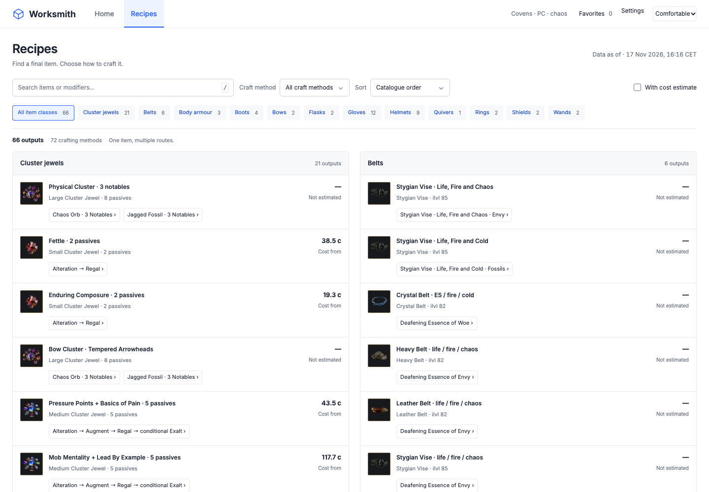
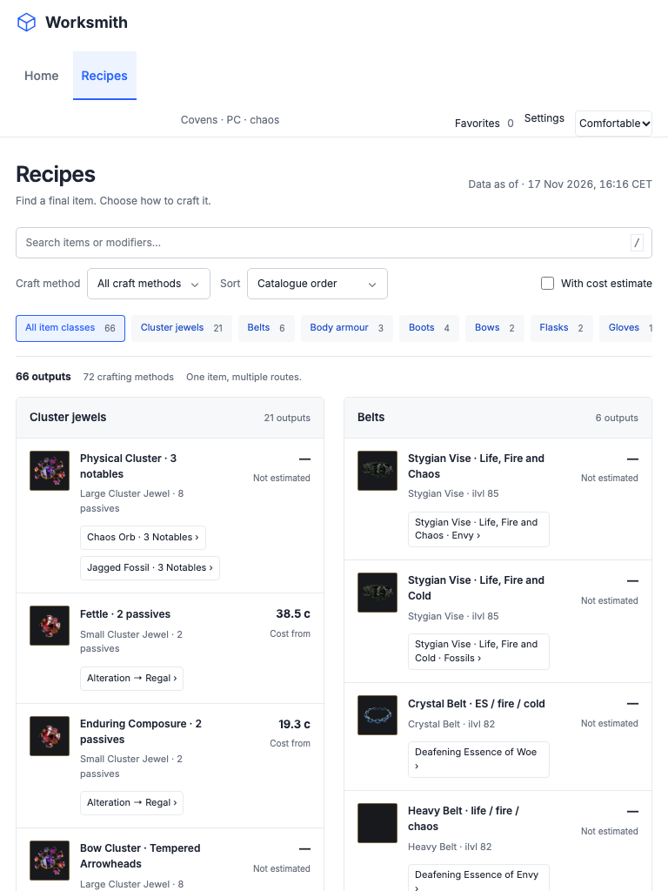
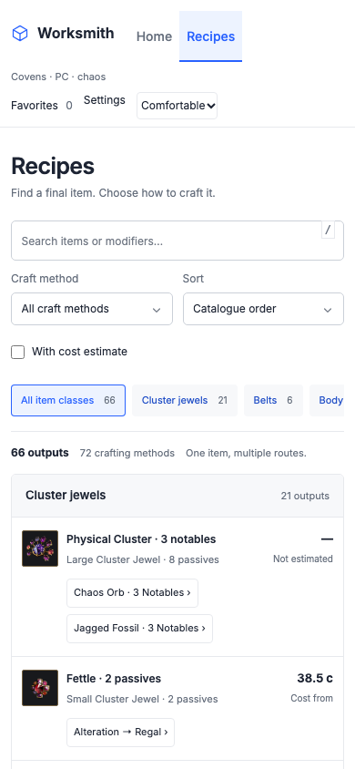
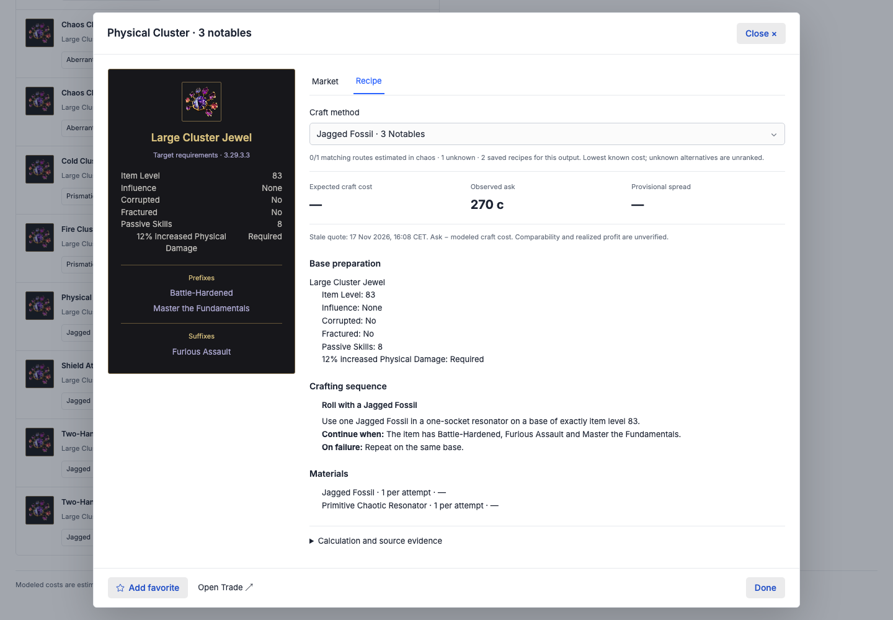
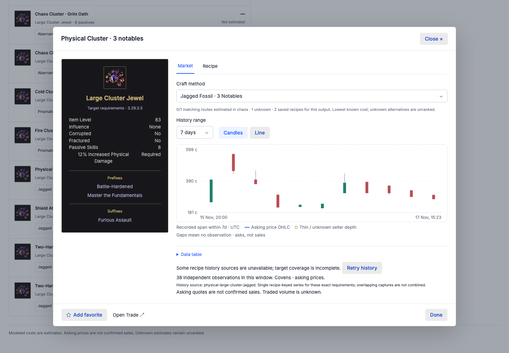

# Category Library verification

The old `/recipes` showed recipe rows mixed with source guides. The new page groups real recipes by the existing exact `targetSignature`, with one output row and separate method buttons. Guide records and deep links remain available.

Design contract: [MAX-1319](https://linear.app/maxsurm/issue/MAX-1319/worksmith-implement-approved-category-library-recipe-catalogue), with shared semantics from [MAX-1318](https://linear.app/maxsurm/issue/MAX-1318/worksmith-implement-approved-mosaic-focus-market-home-and-marketrecipe). Reference: [approved Category Library](https://worksmith-recipes-v2.maxsurm.chatgpt.site/#library), design commit `2d22f19c75549ac23f527073939ce8de4f0bca57`.

## Evidence and provenance

Screenshots use the production entrypoint with intercepted API responses from `apps/web/src/mocks/category-library-archive.json`. They show the historical 17 November archive, **not live production**. The fixture was normalized from the approved private prototype's `data.js` and its exact `MosaicModel` method metadata. Original item artwork URLs are retained. No credentials or access tokens are included.

The fixture contains 66 exact outputs, 72 recipes, six two-method outputs, ten estimated outputs and the two supplied exact procedures. Physical's Jagged history contains 11 four-hour buckets / 38 observations. Fettle's history is empty. Chaos has no supplied archived procedure or history; the test returns an error for that exact ID rather than copying Jagged's response.

Freshness is forced stale. Operational fields absent from the normalized archive remain null where supported. Its required `last24h.completeSpanMinutes` uses a test-only zero placeholder and is never used as market evidence. The fixture is imported only by tests; production receives its catalogue from `/api/catalog`.

## Checks

Executed with Node 22.23.5 and pnpm 11.8.0:

- `pnpm build` — passed; existing large-bundle warning remains.
- `pnpm typecheck`, `pnpm lint` — passed.
- Prettier over every changed source/document file — passed. Repository-wide `prettier --check .` still reports 59 unchanged pre-existing files; none belongs to this PR.
- `pnpm test` — 910 Vitest tests plus the native service-control self-check passed.
- `pnpm test:contracts` — seven provider contract tests passed.
- `pnpm --filter @poe-worksmith/web preview:build` and `pnpm exec playwright test --config playwright.preview.config.ts` — two standalone offline preview checks passed, including the shared popup and retained deep routes.
- `pnpm test:e2e:browser --config playwright.recipes.config.ts` — 20 passed, four viewport duplicates of desktop-only failure/deadline checks skipped.
- `pnpm exec playwright test --config playwright.light.config.ts` — 60 existing browser regression checks passed after adapting removed navigation controls to retained deep-link flows.

The isolated browser configuration starts Vite and intercepts APIs. It does not start, reset or migrate a database. Browser plugin was unavailable; local Playwright supplied screenshots and interaction checks. No browser runtime errors were observed in the catalogue flow.

Checked 1440×1000, 768×1024 and 390×844; 200% zoom; category/family AND filtering; full versus filtered counts; mixed families; unknown/partial costs; source-bound quotes; Fettle's 38.5c cost / provisional +61.5c spread; actual Jagged versus unavailable Chaos instructions; real sibling history without relabeling; empty/partial/failed/timed-out history; reload/Back/Escape; native background inertness and focus trap; opener restoration after favorite removal; legacy favorite aliases; image fallback; density; and catalogue refresh failures retaining useful data.

## Reproduce

1. Run `pnpm build`, then `CAPTURE_CATEGORY_EVIDENCE=1 pnpm test:e2e:browser --config playwright.recipes.config.ts`.
2. At `/recipes`, select Fossil: 12 outputs / 12 routes. Add With cost estimate: empty. Clear filters and enable estimates: ten outputs.
3. Open Physical's Jagged route, switch Market / Recipe, then Back. Family, class, sort, scroll and initiating focus remain.
4. Open Chaos: unavailable exact procedure, without Jagged steps. Search Fettle: one row, 38.5c, empty history.
5. Save a legacy Chaos favorite, filter Fossil, remove it in the Jagged popup, and close. No orphan favorite remains; focus falls back to search when the row disappears.

## Review and dependency boundary

Four incremental Claude Sonnet passes challenged method classification, quote provenance, favorite alias scope, history lookup, currency/rounding, ARIA, timeouts and content-hash compatibility. Retained findings were fixed and checked. A separate code review also caught a legacy query-view header regression; direct-link browser checks verify the fix. Simplification reused the existing snapshot-minimum helper, removed unused metadata/branches and coalesced refreshes; Recipes shares catalogue metadata with the shell through Outlet context, avoiding its duplicate initial fetch and keeping the header league current; unrelated Home loading lifecycles were retained.

This is a compatible target-first **read adapter**, not a new target identity or a migration. Canonical recipe files, signatures, content hashes, existing URLs and stored history are unchanged. Five confirmed Bench finishes are typed read metadata outside hashed recipe definitions. Existing browser favorites are normalized to signatures when read; unknown saved IDs are preserved.

MAX-1318 still owns the complete Mosaic Home, persisted monitor-only target/version relationships, durable target-level history migration and independent monitoring lifecycle. Until then, the shared popup loads existing recipe-keyed histories on demand and displays one real source series with the most observation coverage. It does not sum overlapping method series; missing sources get an explicit warning and Retry. The popup component and pure selector can be reused by that Home implementation.

The additive API fields and web bundle should be released together; cached older strict clients may need a reload.

No database integration, live provider, production deployment, actual crafting or confirmed-sale/ROI verification was performed. Ask-minus-cost stays provisional; verified profit is not unlocked.

## Screenshots

