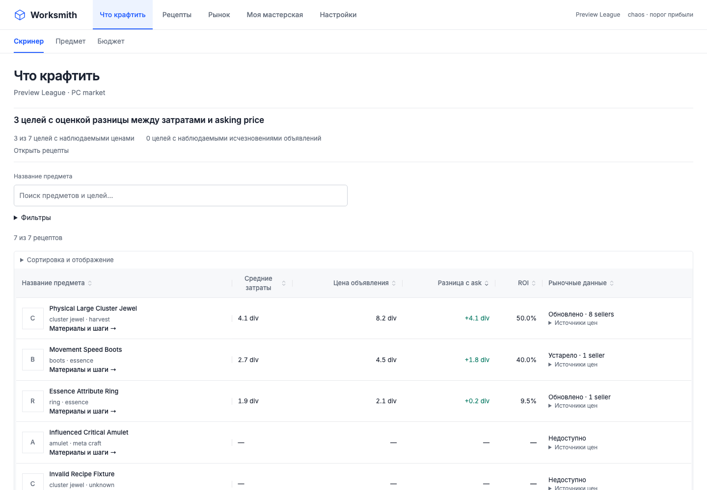
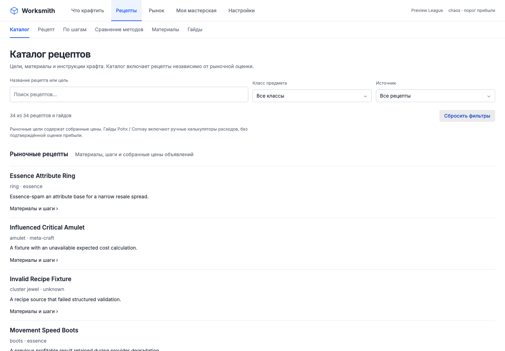
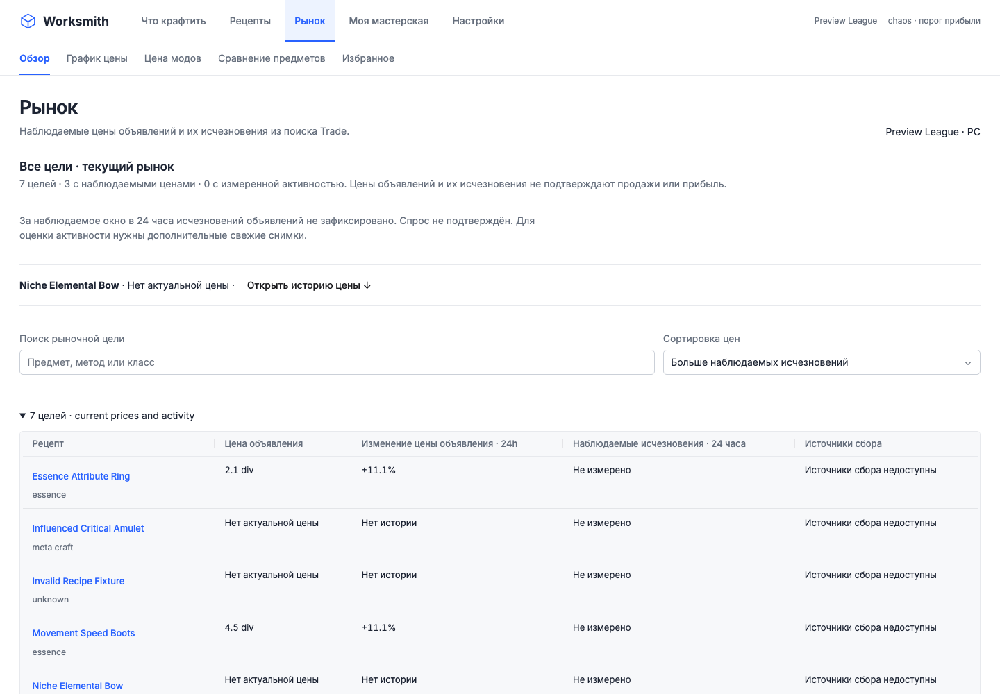
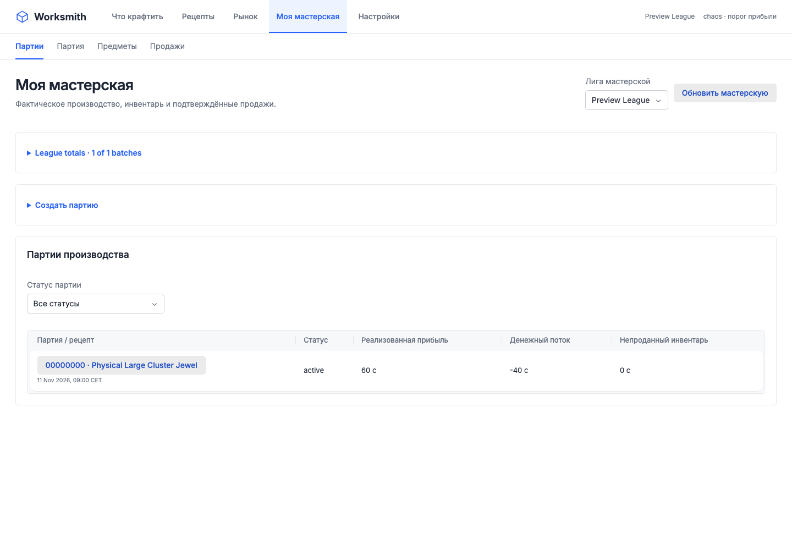
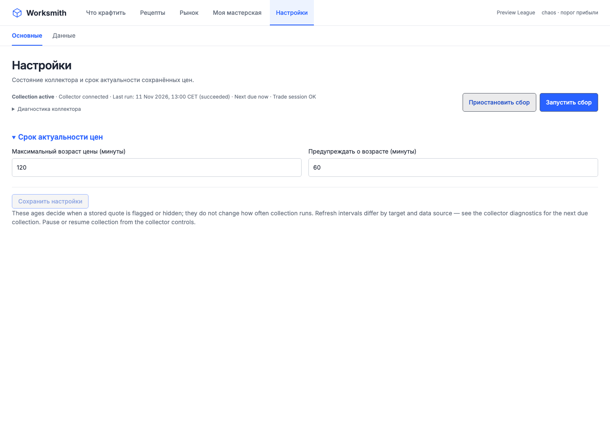
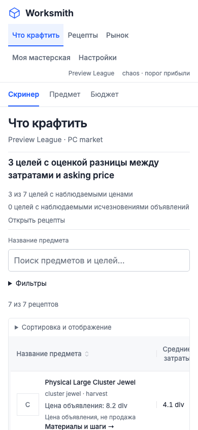

# Светлый интерфейс Worksmith

Изолированная реализация от `origin/master` (`22cd01a`), 17 ноября 2026. Стек React 19, Vite 8, HeroUI 3 и pnpm 11 сохранён. Backend, схемы хранения и правила учёта не изменены.

Утверждённый сайт `https://worksmith-light-templates.maxsurm.chatgpt.site` вернул HTTP 401. В браузере показал вход в ChatGPT; авторизованной сессии не было. Локальные `worksmith-light-templates.html` и `UI-CONTRACT.md` в проверенных каталогах не найдены. Реализация основана на подробной спецификации запроса; визуальное совпадение с закрытым прототипом не подтверждено.

## Покрытие 20 представлений

| №   | Представление       | Маршрут / состояние                              | Реализация                                                                                                                                                                                                                               |
| --- | ------------------- | ------------------------------------------------ | ---------------------------------------------------------------------------------------------------------------------------------------------------------------------------------------------------------------------------------------- |
| 1   | Скринер             | `/?view=screener`                                | Существующий каталог: поиск, фильтры, сортировка, затраты, asking prices, качество и свежесть.                                                                                                                                           |
| 2   | Предмет             | `/?view=item&recipe=:id`                         | База, целевые моды, экономика, источники и переходы выбранного рецепта. Без выбора — каталог выбора.                                                                                                                                     |
| 3   | Бюджет              | `/?view=budget&recipe=:id`                       | Количество, ручные цены и расход; существующая серверная модель риска показана отдельно от ручного плана.                                                                                                                                |
| 4   | Каталог             | `/recipes`                                       | Реальные рецепты и авторские гайды; существующие поиск и фильтры.                                                                                                                                                                        |
| 5   | Рецепт              | `/recipes/:id`                                   | Существующий полный экран с базой, методом, материалами, источниками, экономикой и историей.                                                                                                                                             |
| 6   | По шагам            | `/recipes/:id?view=steps`                        | Проверенные действия, материалы, условия продолжения/восстановления; отметки сохраняются в текущей вкладке браузера. Отсутствующие шаги объяснены.                                                                                       |
| 7   | Сравнение методов   | `/recipes/:id?view=methods`                      | Существующая таблица с проверкой одинаковых `targetSignature` (подпись включает базу и условия цели); при отсутствии второго метода — объяснение.                                                                                        |
| 8   | Материалы           | `/recipes/:id?view=materials`                    | Общий с бюджетом черновик: нужно, есть, докупить, цены, суммы по валютам и копирование/скачивание TSV.                                                                                                                                   |
| 9   | Гайды               | `/recipes?view=guides`, `/recipes/pohx/:guideId` | Существующие материалы Pohx / Convay, источник, дата проверки, исходная лига и предупреждение об актуальности.                                                                                                                           |
| 10  | Рынок: обзор        | `/market`                                        | Существующие цены, продавцы, покрытие и свежесть конкретной цели/снимка.                                                                                                                                                                 |
| 11  | График цены         | `/market?view=history&recipe=:id`                | Существующая история asking prices, периоды, таблица наблюдений и пропуски без интерполяции.                                                                                                                                             |
| 12  | Цена модов          | `/market?view=mods`                              | Объяснённая недоступность: API не предоставляет сопоставимые группы для выделения цены отдельного модификатора.                                                                                                                          |
| 13  | Сравнение предметов | `/market?view=compare&recipe=:id`                | Требования цели против сохранённого объявления; автоматическое соответствие модификаторов неизвестно: API хранит только текст объявления. Числовые диапазоны автоматически не проверяются; парсера пользовательского предмета в API нет. |
| 14  | Избранное           | `/market?view=favorites`                         | Стабильные ID реальных целей, актуальный каталог, удаление, сохранение в этом браузере. Ошибка хранилища не имитирует успех.                                                                                                             |
| 15  | Партии              | `/factory`                                       | Существующий API создания и пагинация, фильтр статуса текущей страницы, фактические показатели.                                                                                                                                          |
| 16  | Партия              | `/factory?view=batch&batch=:id`                  | Существующие план/факт, запасы, предметы, формы событий, журнал и экспорт. Выбранная партия задаёт собственные рецепт и лигу.                                                                                                            |
| 17  | Предметы            | `/factory?view=inventory`                        | Существующий API инвентаря: статусы, сохранённая себестоимость и ссылка на партию; неполное покрытие обозначено.                                                                                                                         |
| 18  | Продажи             | `/factory?view=sales`                            | Существующий API подтверждённых продаж: выручка, распределённая себестоимость, расходы и реализованная прибыль.                                                                                                                          |
| 19  | Основные настройки  | `/settings`                                      | Существующая валидация и сохранение с версией; действия коллектора.                                                                                                                                                                      |
| 20  | Данные              | `/settings?view=data`                            | Существующая диагностика коллектора, качество, свежесть и покрытие целей; loading/empty/error состояния.                                                                                                                                 |

Проверены ссылки на рецепт, партию (включая старую `/factory?batch=:id`) и выбранную цель. Контекст рецепта, явно выбранной лиги и периода сохраняется между разделами. Метод задаётся ID рецепта. Валюта порога прибыли не конвертирует цены и не задаёт валюту операции. При несовпадении лиг цены скрыты, инструкции остаются доступны.

## Связность и границы

- Изменения количества и ручных цен сохраняются при переходе бюджет → материалы и перезагрузке вкладки. Сумма полного плана в одной валюте может заполнить редактируемый **плановый** бюджет партии. Количество переносится в заметку; API партии не имеет отдельного поля планового количества.
- Покупки, списания, производство и продажи создаются только существующими явными формами событий. Черновик материалов ничего не записывает в журнал.
- Разные валюты не складываются без курса. Пустые цены и неизвестный расход не превращаются в ноль. Ручные цены не подменяют серверную модель риска.
- Средние затраты, P50, P90, asking prices и реализованная прибыль остаются отдельными показателями. История и исторические курсы не пересчитываются новым UI.
- Избранное хранится в `localStorage`; шаги и план — в `sessionStorage`. Между устройствами они не синхронизируются. Отдельный черновик создаётся для рецепта, патча, метода, лиги и состава материалов. Цена сохраняется вместе с валютой, источником и доступной датой; изменение валюты котировки не меняет единицу сохранённого числа. Обновление рыночных цен выполняется явно и сохраняет ручные цены. Тестовый просмотр использует отдельное пространство ключей.
- Часть подробных диагностических сообщений и ответы API остаются на английском.
- Объём продаж, надбавки за моды и вероятность продажи не синтезируются из объявлений.

## Проверка

Node 22.23.5, pnpm 11.8.0. Визуальные проверки используют production entrypoint и реальные React-компоненты с явно синтетическими, проверяемыми контрактами API. Запросы перехвачены локально; ни база, ни внешние провайдеры не вызываются. Синтетический журнал в fixture рассчитан существующей доменной проекцией.

- `pnpm lint`, `pnpm typecheck`, `pnpm build` — выполнены. Сборка предупреждает о крупном JS chunk; разделение bundle не входит в эту задачу.
- Исходная проверка `pnpm test`: 891 тест. После ревью повторно проверены изменённый web и все проверки CI; точные итоги — в [отчёте ревью](claude-review.md).
- Исходные 24 browser checks дополнены регрессионными сценариями по замечаниям Claude. `pnpm exec playwright test --config playwright.light.config.ts`: адаптивный обход всех 20 представлений, сохранение цели, бюджет → материалы → партия, ошибки API, избранное, сохранение настроек, инвентарь/продажи и клавиатура на 1440×1000, 768×1024, 390×844.
- `pnpm --filter @poe-worksmith/web preview:build` и `pnpm exec playwright test --config playwright.preview.config.ts` — автономный файл работает без сети; 2 браузерных теста.
- Форматирование изменённых файлов проверяется отдельно. Глобальный `pnpm format:check` также запущен; он сообщает о существующих нарушениях в нетронутых файлах (`.impeccable/config.json`, Drizzle snapshots, старые evidence JSON/Markdown и др.). Эти файлы не переформатированы.
- Самостоятельно просмотрен diff. Проверены отсутствие новых backend-записей из плана, неизменность API учёта, обработка ошибок, каноническая идентичность методов и сохранение контекста ссылок.

PostgreSQL integration/e2e и DB-backed browser suite проверяются в CI с одноразовой тестовой БД; локально Docker и Colima остановлены. Production не обновлялся; визуальная проверка на пользовательской рабочей базе не выполнялась. Итоги повторного CI и независимого ревью записаны в [отчёте](claude-review.md).

## Скриншоты

**Все данные на скриншотах синтетические, только для проверки интерфейса.** Это не результаты текущего рынка или реальные продажи пользователя.

### Что крафтить — 1440×1000

### Рецепты — 1440×1000

### Рынок — 1440×1000

### Мастерская — 1440×1000

### Настройки — 1440×1000

### Мобильный скринер — 390×844

Повторная съёмка: `CAPTURE_LIGHT_EVIDENCE=1 pnpm exec playwright test --config playwright.light.config.ts`. Обычный запуск не перезаписывает изображения в Git. Перед suite нужен `pnpm build`: регрессионная проверка использует настоящий серверный форматтер модификаторов из `apps/server/dist`.
