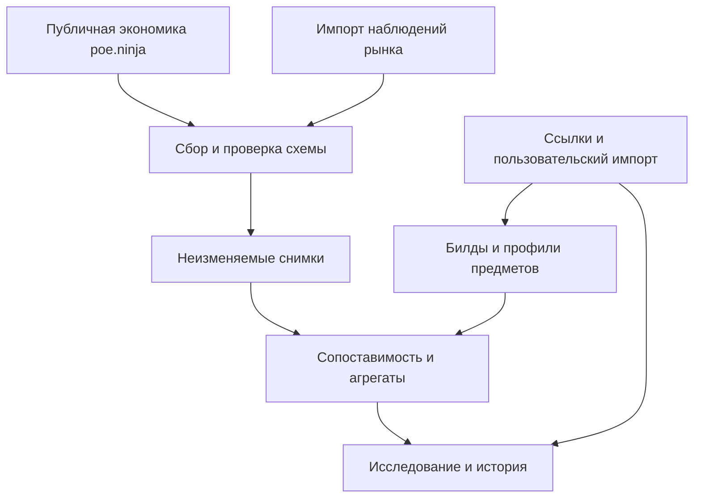
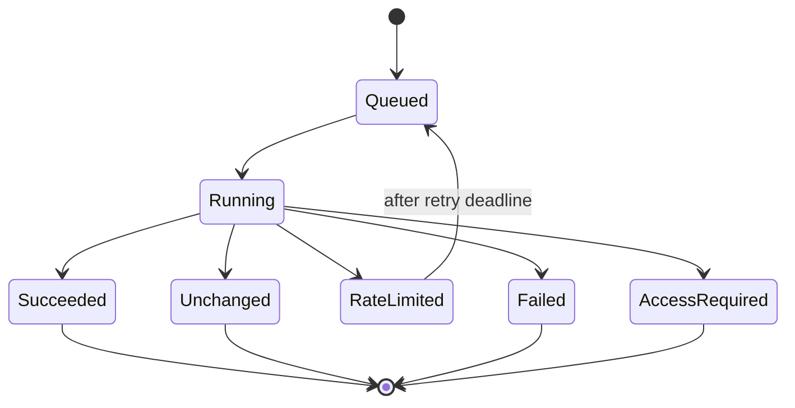

# Crafter Market Intelligence - Plan

## Goal Capsule

- **Objective:** крафтер выбирает, какие предметы исследовать и крафтить в выбранной лиге, по проверяемым потребностям билдов и наблюдениям рынка.
- **Means:** библиотека источников, профили целевых предметов и история наблюдений в существующем TypeScript-приложении (KTD1–KTD4).
- **Authority:** запрос пользователя от 2026-10-29 определяет новое направление; этот план заменяет противоречащие ему положения прежнего [Linear PRD](https://linear.app/maxsurm/document/poe-worksmith-automator-product-requirements-b5273c1d00a2).
- **Execution profile:** сначала работающий сквозной сценарий с импортом наблюдений и публичной экономикой; затем расширение покрытия и автоматизация разрешённых источников.
- **Stop conditions:** конкретный коннектор приостанавливается при отсутствии разрешённого доступа, отзыве доступа или несовместимой схеме. Остальной продукт сохраняет последний успешный результат.
- **Tail ownership:** разработчик доводит M1 до критериев ниже; владелец проекта выбирает первоначальные билды и проверяет гипотезы на рынке. Получение отдельного разрешения поставщика не заменяется обходом его доступа.

---

## Product Contract

### Summary

Первый milestone — рабочее место для исследования рынка крафта PoE 1. Пользователь добавляет источник билда, задаёт требования к предмету, собирает или импортирует сопоставимые рыночные наблюдения и сравнивает снимки во времени. Интерфейс показывает происхождение каждого вывода и отделяет цену предложения от подтверждённой сделки.

### Problem Frame

Существующая система начинает с рецепта и оценивает его стоимость. Главный вопрос пользователя возникает раньше: каким билдам нужны определённые свойства предмета и достаточно ли оснований тратить валюту на такой крафт. Один дорогой лот или популярный ролик не доказывает ни цену продажи, ни устойчивый спрос.

### Key Decisions

- **Начинать с рыночной гипотезы.** Пользователь явно предпочёл ответ «что крафтить» расширению справочника рецептов. Governs R1, R2, R11.
- **Использовать прошлые лиги как историю.** Пользователь допускает начать с уже существующих данных. Governs R3, R7, R8.
- **Сохранить пригодный код.** Полная замена проекта не является условием результата. Governs R12.

### Requirements

**Исследование спроса и предметов**

- R1. Пользователь создаёт гипотезу «профиль предмета нужен этому билду» со ссылками на доказательства.
- R2. Профиль предмета хранит базу, слот, минимальный item level, качество, состояния предмета и обязательные либо желательные свойства независимо от рецепта.
- R3. Каждая гипотеза, запись источника и наблюдение имеют контекст игры, платформы, лиги и версии данных.
- R4. Библиотека источников хранит URL, автора, дату публикации или проверки, тип источника и обоснование связи с билдом.
- R5. Автоматически извлечённые требования остаются предложениями до проверки человеком.

**Рыночные данные**

- R6. Источники подключаются по явно заданным возможностям: цены категорий, наблюдения конкретных лотов, сведения о билдах или справочник предметов.
- R7. Успешный сбор создаёт неизменяемый снимок с временем наблюдения, происхождением, версией нормализатора и ссылкой на исходные данные.
- R8. Исторические данные не смешиваются с актуальными ценами другой лиги; отсутствие архива отображается как отсутствие данных.
- R9. Цена редкого предмета рассчитывается только по наблюдениям сопоставимых предметов с видимыми критериями сравнения.
- R10. Интерфейс показывает размер выборки, доступное покрытие, свежесть и ограничения источника рядом с ценой.
- R11. M1 показывает основания для дальнейшего исследования крафта; прибыль и рекомендация «крафтить сейчас» появляются только при наличии отдельно проверенной модели затрат.

**Интерфейс и эксплуатация**

- R12. Существующие рецепты, миграции и подтверждённые полезные механизмы остаются доступными при добавлении нового направления.
- R13. Пользователь видит список гипотез, страницу предмета с историей, библиотеку источников и журнал сборов.
- R14. Импорт проверяет формат и происхождение данных до сохранения; повторный импорт не удваивает наблюдения.
- R15. Ошибка, пустой ответ, ограничение частоты и отсутствие доступа различаются в интерфейсе.
- R16. После перезапуска сервиса сохранённые гипотезы и снимки доступны без повторного сбора.
- R17. Обновление одного источника не требует успешного обновления всех остальных источников.
- R18. Сервис не принимает пароль игровой учётной записи и не использует пользовательскую сессию как универсальный ключ API.

### Key Flows

- F1. Пользователь добавляет ссылку на гайд или собственный PoB, указывает билд и создаёт профиль желаемого предмета. Связь с источником становится проверяемым основанием гипотезы. Covers R1–R5.
- F2. Пользователь выбирает лигу и источник, запускает разрешённый сбор или импортирует наблюдения. Новый снимок появляется в истории, а предыдущий сохраняется. Covers R6–R10, R14–R17.
- F3. Пользователь открывает гипотезу, сравнивает два снимка и видит, какие свойства, цены и данные о предложении поддерживают её. Недостаточные данные не превращаются в оценку прибыли. Covers R9–R11, R13.

### Acceptance Examples

- AE1. Для одного профиля есть наблюдения двух лиг. При выборе второй лиги первая остаётся доступной только в историческом контексте; текущая оценка не использует её цены. Covers R3, R8.
- AE2. В poe.ninja найден дорогой BaseType, но нет сопоставимых редких предметов. UI показывает стоимость базы и отсутствие оценки конечного предмета. Covers R6, R9, R11.
- AE3. Повторно импортирован тот же файл. История содержит одну исходную запись и корректный журнал повторной попытки. Covers R7, R14.
- AE4. Источник ответил 429 или изменил схему. Предыдущий снимок остаётся доступным со старым временем наблюдения; попытка отображается отдельно. Covers R10, R15, R17.
- AE5. Лот отсутствует в следующей выборке. Система фиксирует «больше не наблюдается», а не «продан». Covers R9, R10.
- AE6. Пользователь открыл экземпляр с демонстрационными данными. Все такие записи явно помечены, а импорт реальных данных не меняет происхождение демонстрационных записей. Covers R7, R10, R14.

### M1 Completion Target

Один пользователь проходит F1–F3 в UI без редактирования БД. Первоначальный размер каталога — ориентир 5 билдов и 10 профилей предметов; эти числа задают объём ручной проверки, а не доказательство охвата рынка. Для демонстрации истории нужны как минимум два достоверных снимка одного набора данных. Снимки могут быть собраны в разные моменты или импортированы из проверенного архива. Данные прошлой лиги не обязательны, пока конкретный доступный архив не подтверждён.

### First Delivery Within M1

Первое изменение закладывает M1: главная страница исследования, создание профиля со ссылками на источники, импорт выбранных пользователем лотов, PostgreSQL-сохранение снимков и их сравнение. Маршрут `/catalog` сохраняет прежний каталог. Отдельный `start:market` поднимает API без запуска старого trade worker.

В этом срезе `market_targets` содержит профиль вместе с его источниками, а `market_research_snapshots` — неизменяемые наблюдения и summary. Разделение библиотеки на самостоятельные build/source-сущности остаётся работой полного M1. Пользователь вручную выбирает сопоставимые лоты, что явно обозначается `comparability: user_selected`; автоматическая проверка свойств ещё не считается готовой.

Контракт импорта принимает одну валюту на снимок, различает `observed` и `demo` и требует явного подтверждения пустого результата. Без доступной PostgreSQL UI показывает `storage: unavailable`, а операция записи завершается ошибкой. Данные в памяти не выдаются за сохранённые.

Публичный `ninjaEconomy.ts` подключён к отдельному economy API, PostgreSQL repository и панели источников. Ручной сбор выбранной категории сохраняет полный ответ, а UI показывает ограниченный preview. Реальный BaseType-ответ проверен отдельно. Миграции и integration-тесты обоих новых repository прошли в CI на PostgreSQL 17; подробности в `docs/market-validation.md`. Этот первый срез не завершает M1: ещё нужны проверка полного перезапуска API и UI-сценария, самостоятельная библиотека, журнал попыток сбора, история последовательных наблюдений и остальные проверки U7. Наличие коннектора и тестов не означает, что сквозная эксплуатация уже проверена.

### Scope Boundaries

В M1 входят публичная экономика poe.ninja, библиотека ссылок, структурированные профили, импорт пользовательских наблюдений, долговечная история и интерфейс сравнения. Первоначально используется PoE 1 PC Softcore Trade; конкретная лига выбирается из данных, а не зашивается в код.

#### Deferred to Follow-Up Work

- Автоматическое извлечение требований из пользовательского PoB и доступных текстов гайдов после стабилизации ручного ввода.
- Полная модель вероятности крафта, стоимости попыток, неудачных исходов и ожидаемой прибыли.
- Исторические потоки GGG Currency Exchange и Public Stash после отдельной проверки условий и доступности.
- Массовое обнаружение билдов, автоматические сигналы изменений меты и уведомления.

#### Outside This Product's Identity

Автоматическая покупка, отправка whisper, управление игровым клиентом и обещания гарантированной прибыли не являются функциями аналитического M1.

### Product Contract Change

Прежние 20 рецептов, Merchant-only выдача, общий TTL, публикация при 95% готовых рецептов и 14 дней истории больше не определяют M1. Они остаются свойствами старого контура там, где ещё нужны. Новое направление вводится отдельно; существующая история не удаляется ради переименования продукта.

---

## Planning Contract

### Repository Baseline

Исходная версия — `MaksimSurmach/POE_WA`, commit `0153d39629db0a957dc6e073a79995fd989fde3e`. В ней уже есть React UI, Fastify API, Drizzle/PostgreSQL, pg-boss, нормализованные сущности предметов, рынок рецептов, повторные попытки и диагностика.

| Existing area                           | Reuse                                      | Required change                                                                          |
| --------------------------------------- | ------------------------------------------ | ---------------------------------------------------------------------------------------- |
| `packages/domain/src/canonical/`        | Требования к модам, база, состояния        | Отделить профиль спроса от рецепта; разрешить неизвестные сведения наблюдаемого предмета |
| `packages/domain/src/gameData.ts`       | Каталог версий, баз, семейств модов        | Зафиксировать ревизию источника и полноту разрешения свойств                             |
| `apps/server/src/schema.ts`             | PostgreSQL и типизированные миграции       | Добавить независимые сущности исследования рынка                                         |
| `apps/server/src/jobs.ts`               | Очередь, расписание, исключение дубликатов | Собственный ограниченный цикл сбора по источнику и лиге                                  |
| `apps/server/src/retryPolicy.ts`        | Повтор временных ошибок                    | Применять правила конкретного поставщика                                                 |
| `apps/server/src/providers/poeNinja.ts` | Старые интерфейсы цен материалов           | Новый публичный economy-коннектор с актуальной схемой                                    |
| `apps/web/src/App.tsx`                  | Навигация и React shell                    | Главный экран исследования; старый каталог отдельным маршрутом                           |
| `apps/server/src/retention.ts`          | Ограниченная очистка порциями              | Исключить новую историческую модель из прежней политики удаления                         |

### Key Technical Decisions

- KTD1. **Добавить отдельный контур market intelligence.** Он использует существующие TypeScript, React, Fastify и PostgreSQL. Старые `market_queries` требуют `recipe_id`, поэтому искусственный рецепт не будет контейнером для гипотезы. Governs R1, R12, R16.
- KTD2. **Хранить предметы как версионируемые профили и наблюдения.** Требования профиля и фактически распознанные свойства лота — разные сущности. Текст мода сохраняется даже при неизвестном ID, тире или типе affix. Governs R2, R3, R9.
- KTD3. **Использовать публичный economy API poe.ninja через backend.** Допустимые routes и категории задаются явным списком. Коннектор поддерживает идентифицирующий User-Agent, ETag и кэш согласно [документации poe.ninja](https://poe.ninja/docs/api). Governs R6, R7, R15.
- KTD4. **Редкие предметы начинать с пользовательского импорта наблюдений.** Автоматический Trade Search не считается доступным публичным API. У [GGG](https://www.pathofexile.com/developer/docs) регистрация новых приложений при проверке была приостановлена; Public Stash требует отдельного уже разрешённого доступа. Governs R6, R9, R18.
- KTD5. **Библиотека билдов начинается с ссылок и явного ввода.** Внутренние builds, character и PoB endpoints poe.ninja не используются. Для YouTube и Reddit хранится ссылка и пользовательское обоснование; извлечение контента требует разрешённого для этого источника пути. Governs R4, R5, R6.
- KTD6. **Разделить сырое содержимое и события наблюдения.** Payload хранится по content hash, а снимок содержит ссылку на него и фактическое время проверки. Ответ 304 не создаёт фиктивное изменение цены. Governs R7, R10, R14.
- KTD7. **Разделить форматы хранения по назначению.** PostgreSQL хранит метаданные, профили, нормализованные строки и агрегаты. Сжатые исходные payload при росте объёма переходят в объектное хранилище через repository-интерфейс. M1 может хранить ограниченные payload в PostgreSQL. Governs R7, R16.
- KTD8. **Давать объяснимые показатели вместо непрозрачного score.** Для каждой гипотезы показываются источники спроса, число сопоставимых лотов, число продавцов при наличии данных, диапазон запрошенных цен и свежесть. Сортировка по цене не называется рейтингом прибыли. Governs R9–R11.
- KTD9. **Сохранять исторические агрегаты через смену лиги.** Предлагаемая стартовая политика: исходные payload 30 дней, агрегаты и ссылки на их происхождение 12 месяцев. Применение политики настраивается отдельно от старого retention; удаление raw явно отмечается в истории. Governs R7, R8, R16.
- KTD10. **Сбором управляет backend worker.** Запуски имеют idempotency key и бюджет запросов; браузер читает результаты через API. По умолчанию сбор poe.ninja не чаще его опубликованной частоты обновления. Governs R15–R17.

### Data Model

Таблица описывает целевую модель полного M1. Первое изменение использует компактные таблицы из First Delivery Within M1; их последующее разделение выполняется добавочными миграциями.

| Entity                  | Core fields                                                                               | Purpose                            |
| ----------------------- | ----------------------------------------------------------------------------------------- | ---------------------------------- |
| `research_sources`      | URL, kind, author, publishedAt, checkedAt, game, league, patch, notes                     | Происхождение утверждений о билдах |
| `build_profiles`        | name, skills, archetype, progressionStage, source links                                   | Контекст потребности в предмете    |
| `item_profiles`         | slot, base IDs, item-level range, quality, flags, constraints, revision                   | Требования покупателя              |
| `build_item_links`      | build, item profile, source, rationale, reviewState                                       | Проверяемая гипотеза спроса        |
| `collection_runs`       | provider, scope, startedAt, finishedAt, outcome, error                                    | Отдельная попытка сбора            |
| `market_snapshots`      | scope, observedAt, fetchedAt, hash, normalizerVersion, payload reference                  | Неизменяемая точка истории         |
| `market_observations`   | snapshot, item identity, price kind, original currency, normalized amount, match evidence | Нормализованные строки выборки     |
| `currency_observations` | source snapshot, pair, quote time, rate                                                   | Воспроизводимая конвертация цен    |

Scope включает game, realm, league, source category, query/profile revision и версию игровых данных. Quality, influences, corrupted, fractured, synthesised, mirrored и прочие значимые состояния не сводятся к имени базы. Для кластеров нужны варианты passives; для связанных сокетов — sockets/links; неизвестное значение хранится как неизвестное.

Импорт хранит исходную цену и валюту. Перевод в chaos/divine привязан к конкретному снимку курса. Если курса нет, строка не участвует в агрегате нормализованной цены. `BaseType` в poe.ninja не является оценкой любого rare на этой базе.

### High-Level Technical Design

Collection run имеет собственный исход; опубликованный снимок не меняет своё время при неудачной попытке. Детали source policy и статус доступа видны в журнале источников.

### Assumptions

- Первым пользователем является владелец проекта; публичный multi-user SaaS не нужен для проверки M1.
- Источники и профили можно первоначально заполнить руками. Это сохраняет полезность продукта до появления проверенного автоматического источника спроса.
- Сроки лиги и текущие популярные билды уточняются отдельно; фиктивные названия лиг и цены не выдаются за актуальные.
- Предложенные объём каталога и retention — рабочие значения для M1, а не согласованные ранее ограничения.

### Deferred Questions

- Есть ли у владельца ранее одобренный GGG OAuth client с `service:psapi`? Это определяет последующий публичный stash-коннектор и не блокирует импорт.
- Какой конкретный архив прошлой лиги доступен с проверяемым происхождением? До ответа интерфейс показывает только фактически полученную историю.
- Какие 5 билдов приоритетны для первого ручного каталога? Профили нельзя объявлять популярными без источника и даты.

---

## Implementation Units

### U1. Market research contracts and item profiles

**Goal:** отделить гипотезу спроса от рецепта.

**Requirements:** R1–R5, R9, R10. **Dependencies:** none.

**Files:** `packages/contracts/src/market.ts`, `packages/contracts/src/market.test.ts`, `packages/contracts/src/index.ts`, `packages/domain/src/canonical/item.ts`, `packages/domain/src/canonical/target.ts`.

**Approach:** определить контракты источника, билда, профиля, снимка и статуса качества данных по KTD2. Использовать существующий Zod-подход; оставить возможность хранить неизвестные свойства наблюдаемого лота.

**Test scenarios:**

1. Минимальный профиль проходит проверку; противоречивый диапазон item level отклоняется.
2. Неизвестный mod ID сохраняет raw text и не превращается в точное совпадение.
3. Данные разных лиг получают разные идентификаторы scope. Covers AE1.
4. Профиль без ссылки на рецепт допустим.

**Verification:** все внешние границы используют единый валидируемый контракт.

### U2. Durable snapshots and research repositories

**Goal:** сохранять исследования и снимки независимо от старого refresh cycle.

**Requirements:** R3, R7, R8, R12, R14, R16. **Dependencies:** U1.

**Files:** `apps/server/src/schema.ts`, `apps/server/drizzle/0014_market_research.sql`, `apps/server/src/repositories/marketResearchRepository.ts`, `apps/server/src/repositories/marketResearchRepository.integration.test.ts`, `apps/server/src/retention.ts`, `docs/database.md`.

**Approach:** начать с `market_targets` и `market_research_snapshots`, затем выделить source/build-сущности добавочными миграциями по KTD1, KTD6 и KTD7. Сохранять попытку сбора отдельно от снимка, исключить новую историю из прежней очистки по KTD9.

**Test scenarios:**

1. Миграция применяется к существующей БД без потери recipes и старых snapshots.
2. Повторный импорт одного payload не удваивает строки. Covers AE3.
3. Перезапуск сервиса сохраняет ранее созданный профиль и историю.
4. Очистка старого контура не удаляет новую историческую выборку.

**Verification:** чтение после новой сессии БД возвращает те же scope, цены и provenance.

### U3. Supported economy collector

**Goal:** получать реальные цены публичной экономики с воспроизводимыми снимками.

**Requirements:** R6, R7, R10, R15, R17, R18. **Dependencies:** U1, U2.

**Files:** `apps/server/src/providers/ninjaEconomy.ts`, `apps/server/src/providers/ninjaEconomy.test.ts`, `apps/server/src/jobs.ts`, `apps/server/src/runtimeConfig.ts`, `apps/server/src/marketEconomy.ts`, `apps/server/src/marketEconomyApi.ts`, `apps/server/src/marketEconomyApi.test.ts`, `apps/server/src/repositories/marketEconomyRepository.ts`, `apps/server/drizzle/0015_market_economy.sql`.

**Approach:** применить KTD3 и KTD10. Начать с leagues, Currency и BaseType; дополнительные категории добавлять после проверки их схемы. Разделить exchange `primaryValue` и stash `chaosValue`; валюту exchange читать из `core.primary`.

**Test scenarios:**

1. Реальный обезличенный пример каждой поддерживаемой схемы нормализуется с правильной валютой.
2. ETag передаётся повторно; 304 сохраняет происхождение исходного наблюдения.
3. 429, timeout и несовместимая схема дают разные исходы и сохраняют прежний результат. Covers AE4.
4. Произвольный hostname, category или внутренний builds endpoint не может попасть в запрос.
5. Нулевая цена, отсутствующая цена и пустая выборка различаются.

**Verification:** ограниченный ручной запуск сохраняет снимок доступного источника и отображает время, категорию и число строк.

### U4. Research library and market observation import

**Goal:** связать билд с профилем и добавить редкие предметы без зависимости от закрытого API.

**Requirements:** R1, R4–R6, R9, R14, R18. **Dependencies:** U1, U2.

**Files:** `apps/server/src/marketResearch.ts`, `apps/server/src/marketResearch.test.ts`, `apps/server/src/marketIntelligence/sources.ts`, `apps/server/src/marketIntelligence/sources.test.ts`, `docs/market-observation-format.md`.

**Approach:** предоставить явный JSON-формат наблюдения и редактор источников по KTD4 и KTD5. Файл содержит источник, scope, observedAt и цену предложения; сервер не посещает произвольный URL ради импорта. Ограничить размер и число записей до разбора.

**Test scenarios:**

1. Валидный файл создаёт источник и снимок с исходными ценами.
2. Несоответствующая лига, недопустимое время, некорректная цена и превышение размера отклоняются с понятной ошибкой.
3. URL источника отображается как ссылка и не выполняется как HTML.
4. Демонстрационные записи сохраняют свою маркировку. Covers AE6.

**Verification:** пользователь импортирует файл через UI и просматривает его отдельный снимок.

### U5. Comparable-item analysis and history

**Goal:** показать, на каких наблюдениях держится рыночная гипотеза.

**Requirements:** R8–R11. **Dependencies:** U1, U2, U4.

**Files:** `packages/domain/src/marketIntelligence.ts`, `packages/domain/src/marketIntelligence.test.ts`, `apps/server/src/marketIntelligence/analysis.ts`, `apps/server/src/marketIntelligence/analysis.test.ts`.

**Approach:** первый срез считает агрегаты пользовательской выборки с явной маркировкой её происхождения; полный M1 добавляет проверку свойств по KTD2 и KTD8. Сравнивать обязательные свойства перед вычислением диапазона цен. Сохранять причины исключения строк; учитывать известный способ отбора, например только дешёвую часть выдачи.

**Test scenarios:**

1. Высокая цена базы не создаёт оценку rare. Covers AE2.
2. Лот с неподходящим обязательным свойством исключается с объяснением.
3. Неполный предмет получает статус неопределённой сопоставимости.
4. Смешанные валюты без подтверждённого курса не попадают в общий агрегат.
5. Исчезновение лота не увеличивает счётчик продаж. Covers AE5.

**Verification:** любой агрегат раскрывается до списка использованных наблюдений и причин исключения.

### U6. Market workspace UI and API

**Goal:** пройти исследование от источника до истории в одном интерфейсе.

**Requirements:** R1, R10–R15. **Dependencies:** U1–U5.

**Files:** `apps/server/src/api.ts`, `apps/server/src/marketResearchApi.ts`, `apps/server/src/marketResearchApi.test.ts`, `apps/web/src/App.tsx`, `apps/web/src/MarketPage.tsx`, `apps/web/src/marketWorkbench.test.ts`, `apps/web/src/market.css`, `apps/web/src/marketClient.ts`, `apps/web/src/marketWorkbench.ts`, `apps/web/src/marketDemo.ts`.

**Approach:** сделать главным экраном список гипотез с фильтрами по лиге, слоту, билду и полноте данных. Страница профиля раскрывает требования, источники и историю. Отдельные представления показывают библиотеку и журнал сборов. Старый каталог рецептов остаётся отдельным маршрутом по R12.

**Test scenarios:**

1. Пользователь создаёт источник, профиль и связь с билдом; они сохраняются после перезагрузки.
2. Выбор лиги фильтрует все цены и историю согласованно. Covers AE1.
3. Ошибки импорта и источника доступны пользователю клавиатуры.
4. Нет данных — отдельное состояние без подставленных рыночных значений.
5. Страница показывает исходную цену, размер выборки, дату и ссылку на доказательство.

**Verification:** F1–F3 доступны на настольном и узком экране; реальные и демонстрационные данные различимы.

### U7. End-to-end M1 and source runbook

**Goal:** проверить, что первый milestone даёт воспроизводимый результат.

**Requirements:** R7, R12, R14–R18. **Dependencies:** U1–U6.

**Files:** `apps/server/src/marketIntelligence.e2e.integration.test.ts`, `apps/web/src/marketWorkbench.test.ts`, `docs/market-data-sources.md`, `README.md`.

**Approach:** проверить полный сценарий с PostgreSQL и ограниченным публичным сбором. Описать отдельно настройку доступных источников, импорт, неизвестные источники редких цен и восстановление после ошибки.

**Test scenarios:**

1. Два последовательных снимка одного scope появляются в UI и переживают перезапуск.
2. Ошибка второго сбора сохраняет первый снимок и ошибку попытки раздельно.
3. Старт без игровых credentials позволяет использовать публичную экономику и импорт.
4. Старый каталог остаётся доступным после миграции и смены главного экрана.

**Verification:** результат подтверждается сохранёнными snapshot IDs, тестами сохранности и проверкой пользовательского сценария.

---

## Verification Contract

| Check                    | Scope            | Evidence required                                                               |
| ------------------------ | ---------------- | ------------------------------------------------------------------------------- |
| `pnpm typecheck`         | U1–U6            | Совместимые типы contracts, domain, server и web                                |
| `pnpm test`              | U1, U3–U6        | Проверка валют, scope, импорта, сравнения и состояний UI                        |
| `pnpm test:integration`  | U2, U7           | Миграция, дедупликация, сохранность и чтение после перезапуска                  |
| `pnpm build`             | U3, U6, U7       | Собираются API, worker и браузерный клиент                                      |
| `pnpm lint`              | Изменённые файлы | Отсутствуют ошибки правил проекта                                               |
| Ручной ограниченный сбор | U3, U7           | Реальный разрешённый источник, время и hash ответа; отсутствие секретов в логах |
| Проверка UI              | U6, U7           | F1–F3, клавиатура, узкий экран, loading/empty/stale/error                       |

Node 22 и pnpm 11 заданы текущим репозиторием. Если доступное окружение отличается или нет PostgreSQL, выполненные проверки перечисляются отдельно от невыполненных. Использование моков не подтверждает работоспособность внешнего источника. Ни одна проверка не требует массового сбора лотов или игровых учётных данных.

---

## Definition of Done

M1 завершён, когда выполнены R1–R18 и F1–F3 на сохраняемых данных, а AE1–AE6 имеют подтверждение. Присутствуют как минимум два достоверных снимка одного scope и полный путь от источника билда до наблюдений предмета. Новые таблицы мигрируются без удаления прежнего каталога.

Сбор публичной экономики может быть работоспособен независимо от доступа к редким листингам. Отсутствие такого доступа явно отражается в UI и документации; оно не маскируется демонстрационными ценами. Доставленная часть M1 обозначается как часть milestone до выполнения остальных критериев.

Из итогового изменения убраны временные эксперименты, неиспользуемые адаптеры и ложные кнопки действий. Остаются только проверенные пути и явные состояния недоступности.

---

## Sources and Risks

| Source / evidence                                                         | Consequence for this plan                                                                                 |
| ------------------------------------------------------------------------- | --------------------------------------------------------------------------------------------------------- |
| [GGG developer documentation](https://www.pathofexile.com/developer/docs) | KTD4, R18: поддерживаемый API не равен всем запросам игрового сайта                                       |
| [GGG API reference](https://www.pathofexile.com/developer/docs/reference) | Public Stash и Currency Exchange имеют разные требования к доступу и разные данные                        |
| [GGG changelog](https://www.pathofexile.com/developer/docs/changelog)     | Формат предметов меняется; raw payload и версия нормализатора обязательны                                 |
| [poe.ninja public API](https://poe.ninja/docs/api)                        | KTD3, KTD5: economy разрешён; внутренние endpoints билдов не используются                                 |
| [RePoE PoE1 exports](https://repoe-fork.github.io/poe1.html)              | Справочник баз и модов привязывается к версии/commit; software license не заменяет условия игровых данных |
| `apps/server/src/schema.ts`                                               | Старые market queries связаны с recipes; новый контур требует независимых сущностей                       |
| `apps/server/src/retention.ts`                                            | Старые 72 часа raw и 14 дней aggregates не удовлетворяют истории лиг                                      |
| `packages/domain/src/gameData.ts`                                         | Уже существует версия игровых данных и каталог баз/модов, который можно расширить                         |

Условия и routes проверялись 2026-10-29 и должны перепроверяться перед включением нового коннектора. Изменение схемы останавливает нормализацию этого источника, сохраняя полученный payload для диагностики без выдачи ложных цен.

Выборка объявлений может быть смещена, сконцентрирована у одного продавца или намеренно завышена. UI раскрывает способ отбора и число доступных наблюдений. Цена запроса, частота использования предмета и факт продажи остаются разными показателями.
